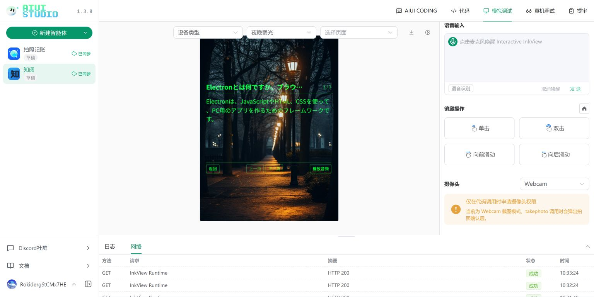

# 绑定与文章加载的运行时修复 · 2026-11-17

用户报告：眼镜已登录但显示“文章加载失败”；Studio 模拟器绑定时显示“无法获取绑定码”。本轮在用户已打开的 AIUI Studio Global「知阅」工程中排查、修改并验证，未把 VM 测试当作现场验收。

## 现场根因与此前遗漏

1. **两个存储接口共用底层。** 旧适配器通过 `wx.setStorageSync` 写入并读回成功后，又调用 `localStorage.removeItem` 清理“旧副本”。当前 QuickJS 模拟器里，两者实际操作同一份数据，因此清理会删掉刚保存的设备标识或授权。非敏感标记对照结果为 `shared-read=true deletion-shared=true`。设备标识读回校验失败，网络面板没有授权请求；临时阶段日志确认失败发生在 device-id verify。
2. **当前模拟器的键值存储不能跨重新运行保留。** 修复误删后，授权码返回 201，用户确认后成功读取 31 篇真实发布文章和正文，但“重新运行智能体”仍回到未绑定。用自建非敏感标记做对照，重开后 `prior-kv=false`、`prior-opfs=true`，且 OPFS 写入读回成功。这仅描述当前 Studio 的实测行为，不推断所有固件相同。
3. **Crypto 兼容性缺陷仍需保留修复。** 安装 UUID 曾无条件依赖 `crypto.getRandomValues`，缺失或调用失败也会在请求前中断。此前只修 Crypto 的 v1 源码包不足以解决当前 Studio 的存储问题。旧测试始终注入 Web Crypto，并把两个存储接口建模为独立、跨运行保留的 Map，遗漏了上述现场边界。

所有临时探针和阶段诊断均已从交付源码及 Studio 的五个修改文件中移除；未打印或导出真实访问及刷新凭据。

## 最终实现与安全边界

- `lib/storage.js` 优先使用智能体私有 OPFS 文件 `zhiyue-credentials-v1.json`，保存按知声来源隔离的安装 UUID、访问/刷新凭据和撤销标记。启动先异步恢复，再让页面判断账号状态；初始化失败显示读取错误，不当成未绑定覆盖旧数据。
- 写入串行处理，显式截断、定位、写入、关闭，再读回核对。配对先等待可靠保存再确认；设备 ID 保存完成后才发出请求；续期与撤销也等待相应写入。文件损坏或已提供的文件后端报错时拒绝继续，不静默降级为临时内存。
- 没有 OPFS API 的旧宿主保留原生键值兼容路径。原生与 localStorage 共用底层时不再跨接口删键；撤销同步写删除标记，防止旧副本复活。有文件能力时可迁移仍存在的原生/旧存储数据。
- UUID 有可用 Crypto 时仍优先使用，缺失或失败则以兼容随机源生成。它只用于设备去重；访问及刷新凭据始终由知声签发，不使用这里的随机源。
- 初版继续采用应用私有软件存储，不引入硬件加密要求；只读、账号隔离、主动撤销和改密码撤销规则保持。正文与音频不写入凭据文件，知阅仍仅读取已发布文章。
- 没有改知声后端或安全配置，本修复无需新增知声提交或迁移。对已经被旧实现删除的本地凭据无法凭空恢复，需重新配对一次；仍存在的有效授权不应清空。

实现依据：[AIUI 存储接口](https://open.rokid.com/aiui/api/storage/storage-api?lang=en-US&version=0.19.0)、[智能体私有 OPFS 与 close 提交语义](https://open.rokid.com/aiui/api/storage/opfs?lang=en-US&version=0.19.0)。是否跨运行保留由上述现场对照单独验证。

## 验证结果

| 范围 | 证据与结果 |
| --- | --- |
| 客户端回归 | `node --experimental-vm-modules --test --test-reporter=spec tests/aiui-client.test.mjs`：本次独立提交快照 63 项全部通过，0 跳过；含此前独立语音开发的完整工作区已通过 69 项，本次不提交语音检索。覆盖共用底层、键值清空后的文件恢复、跨两天自动续期、稳定 UUID、截断、落盘门禁、写入失败与撤销标记。 |
| 既有隔离 HTTP | 无 Crypto 客户端在一次性本机 PostgreSQL 上完成配对、确认、读取、多轮续期、网页退出及密码撤销。该用例使用注入存储，不作为 OPFS 的验证证据。 |
| 实际 Studio 首次配对 | 修复后 `/device/authorize` 返回 201；由用户亲自批准新码。等待批准时的 400 已核对为 `authorization_pending`。 |
| 实际 Studio 真实读取 | 最终文件存储版本在用户确认后加载 31 篇发布文章，列表请求 200。确认 204 转发等待仍由既有十秒超时和续期探测恢复。 |
| 实际 Studio 重新运行 | 未再批准或重新配对，直接恢复 31 篇列表，新的 GET 返回 200；再打开第一篇真实正文，GET 200，页码 1/3。见下方截图。 |
| 源码一致性 | Studio 的五个修改文件与现场工作区逐个比对，规范化换行后的内容指纹及长度一致。本次提交快照在相同绑定修复基础上排除独立语音改动，并单独通过 63 项测试。 |
| 待验收 | 新眼镜包安装、目标固件关闭重开、真实跨日/长期闲置、更新包后的保留及真实密码撤销，仍未在本轮验收。 |

## 交付和状态

使用 [v3 独立修复源码包](../artifacts/zhiyue-binding-runtime-fix-v3-20261117.zip)及[SHA-256](../artifacts/zhiyue-binding-runtime-fix-v3-20261117.sha256)，或重新打包当前 `aiui/`。v3 仅包含本次 Git 提交的绑定与加载修复，不包含工作区独立语音改动；它替代本日 Crypto-only v1 和 11 月 16 日历史源码包。此前 v2 是含本地语音开发的现场快照，仍留在本地但不纳入本次提交。保留同一个智能体与安装身份，不主动清空已有授权。

本次绑定与加载修复随当前功能分支提交交付；现场 Studio 已更新保存，尚未给眼镜安装新资源包。模拟器成功不等于真机、跨日或发布验收通过。
